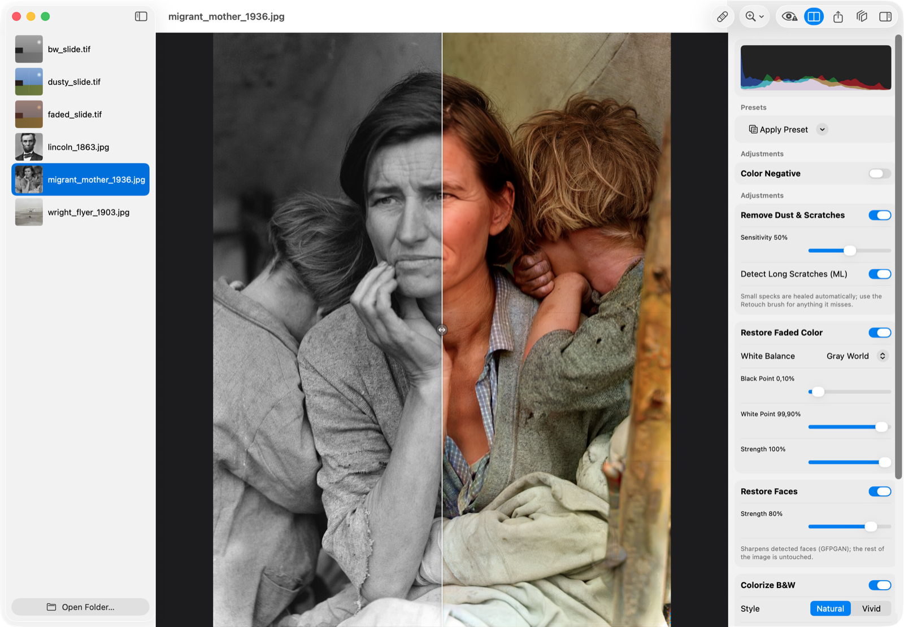
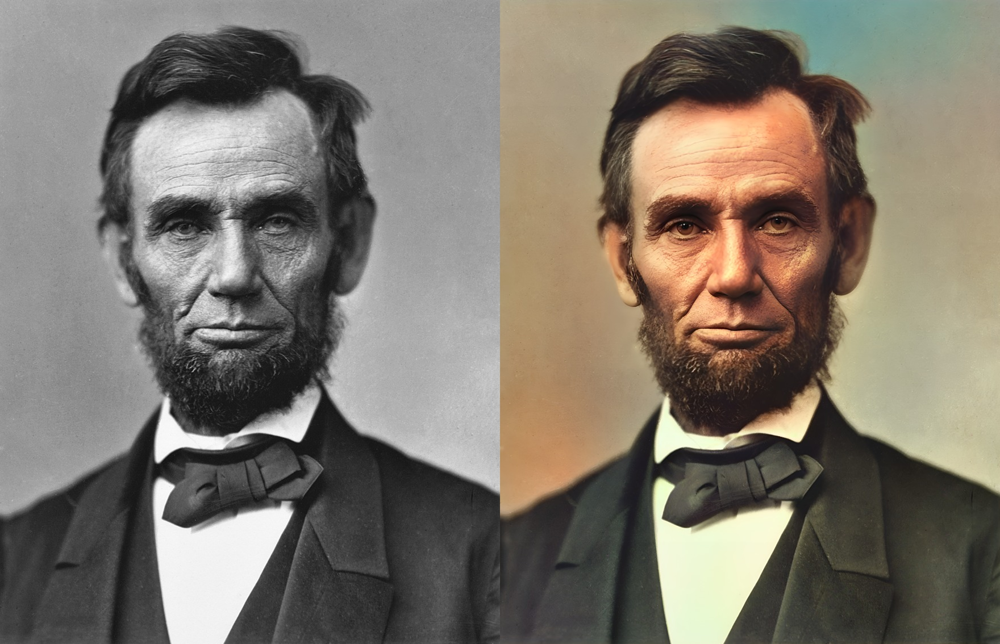
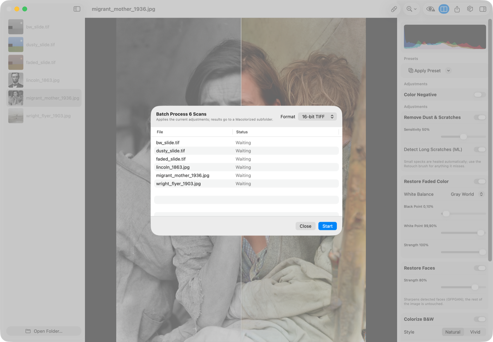

# Macolorize

A native macOS app that restores scanned 35mm slides and old photos — fully
on-device, no cloud. SwiftUI + Core ML on Apple Silicon.



*Dorothea Lange's "Migrant Mother" (1936, Library of Congress, public domain) —
original left of the compare wipe; dust-cleaned, colorized, and face-restored
on the right. Everything computed locally.*

## Before / after



*Alexander Gardner's 1863 Lincoln portrait (public domain) through the full
pipeline — dust & scratch removal, GFPGAN face restoration, DDColor
colorization, grain reduction, and 2× super-resolution: 20 seconds on an
M-series Mac, output 4400×5670 16-bit TIFF.*

## What it does

| Stage | Method | Runs on |
|---|---|---|
| Color negative | Film-base estimation + linear-light inversion (no ML) | GPU (Core Image) |
| Remove dust & scratches | Classical outlier detection + BOPBTL scratch U-Net (MIT) → LaMa inpainting (Apache-2.0) | GPU |
| Manual retouch brush | Heal (LaMa) or paint color hints, live preview | GPU |
| Restore faded color | Per-channel percentile stretch + gray-world balance (no ML) | GPU (Core Image) |
| Restore faces | GFPGAN v1.4 (Apache-2.0) + Vision-framework alignment, feathered paste-back | GPU |
| Colorize B&W | DDColor Natural/Vivid (Apache-2.0), full-res luminance preserved via Lab merge, steerable with painted color hints | ANE/GPU |
| Reduce film grain | DRUNet blind denoiser (MIT) with adjustable strength | ANE/GPU |
| Sharpen & upscale | Real-ESRGAN ×2/×4 (BSD-3), tiled with seam-free stitching | ANE/GPU |

Interactive editing with a before/after wipe (⌘\), live RGB histogram, a
red-overlay preview of what dust removal will heal, plus batch processing of
whole folders (⌘B) with the current settings:



Recipes are saved as presets and per-image sidecars (`.macolorize/` next to
your scans) so edits survive restarts. Exports are non-destructive 16-bit TIFF
(or PNG/JPEG) into a `Macolorized` subfolder with EXIF/IPTC preserved —
originals are never touched.

**Why not just ask a chatbot to "colorize and fix" a photo?** Generative
editors redraw the whole image — faces subtly change, detail is invented, and
you get a small JPEG back. Macolorize keeps your actual pixels: luminance is
preserved exactly through colorization (unit-tested), only detected defects
and faces are re-synthesized, and you keep full resolution, 16-bit depth,
batch throughput, and privacy.

## Install

Grab **Macolorize.app** from [Releases](../../releases) (models included,
ready to run), or build from source:

```sh
make models   # one-time: download weights + convert to Core ML (~2.5 GB traffic)
make build    # generate the Xcode project and build
make run      # launch the app
make test     # unit tests
```

Requirements to build: Xcode 16+, [XcodeGen](https://github.com/yonaskolb/XcodeGen),
[uv](https://docs.astral.sh/uv/) (for the one-time model conversion). The app
works without the models — ML stages appear disabled until `make models` has
produced `Models/*.mlpackage`.

## Command line

`MacolorizeCLI` runs the identical pipeline headlessly:

```sh
macolorize-cli --emit-recipe recipe.json         # write a template recipe
macolorize-cli --recipe recipe.json scan.tif     # single file
macolorize-cli --recipe recipe.json ScanFolder/  # whole folder
macolorize-cli --restore --format jpeg scan.tif  # quick fade fix
macolorize-cli --mask defects.png scan.tif       # inpaint masked regions
```

## Keyboard shortcuts

- ⌘O open folder · ⌘B batch process folder
- ⌘R restore · ⌘K colorize · ⌘F faces · ⌘T retouch brush · ⌘\ compare
- ⌘[ / ⌘] rotate · double-click the canvas to reset zoom; pinch to zoom, drag to pan.

The retouch brush has two tools: **Heal** (LaMa inpaints the stroke) and
**Color** (pick a color; the colorizer honors it in that region). The eye
toolbar button previews the dust/scratch detection mask in red.

## Layout

- `Macolorize/Pipeline` — recipe, engine, stages (negative/clean/restore/faces/colorize/denoise/sharpen/inpaint)
- `Macolorize/ML` — model store, tile grid, tiled runner, Lab color kernel, face alignment
- `Macolorize/IO` — 16-bit TIFF loading, metadata-preserving export, sidecars
- `tools/` — Python (uv) scripts converting the six models to Core ML
- `Models/` — generated `.mlpackage` files (gitignored; recreate with `make models`)

## Credits

Models: [DDColor](https://github.com/piddnad/DDColor) (Apache-2.0),
[LaMa](https://github.com/advimman/lama) (Apache-2.0, conversion adapted from
[CoreMLaMa](https://github.com/mallman/CoreMLaMa)),
[GFPGAN](https://github.com/TencentARC/GFPGAN) (Apache-2.0),
[Real-ESRGAN](https://github.com/xinntao/Real-ESRGAN) (BSD-3),
[DRUNet](https://github.com/cszn/KAIR) (MIT),
[Bringing Old Photos Back to Life](https://github.com/microsoft/Bringing-Old-Photos-Back-to-Life) scratch detector (MIT).

Sample photos in `SampleImages/` and screenshots use public-domain material
(Library of Congress / Wikimedia Commons) and synthetic test scans only.
